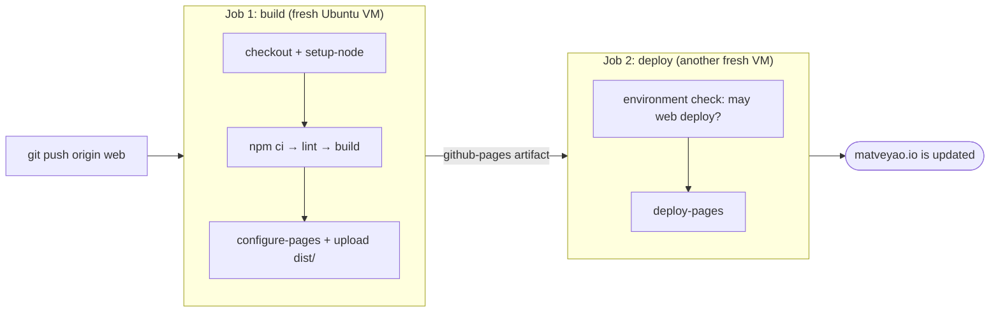

# GitHub Actions, Explained with a Real Deploy

**Learn how a GitHub Actions workflow works by taking apart the one that builds and ships this repo's website.**

---

## The Scenario

This repo has a website, [matveyao.io](https://matveyao.io). Its source lives on the
[`web`](https://github.com/000Matvey000/OneCoolThing/tree/web) branch, and every time someone pushes to `web`,
GitHub Actions:

1. spins up a fresh Linux machine,
2. installs the dependencies, lints and builds the React site,
3. hands the build to GitHub Pages, which puts it live.

All of that is driven by one 48-line file:
[`.github/workflows/deploy.yml`](https://github.com/000Matvey000/OneCoolThing/blob/web/.github/workflows/deploy.yml).
A fully commented copy sits next to this lesson in [`deploy.annotated.yml`](deploy.annotated.yml).

> **Why a separate branch?** That's its own cool thing — see [PagesFromABranch](../PagesFromABranch/).
> This lesson is about the workflow file itself.

---

## Six Words You Need

| Term | What it is | In our workflow |
| ---- | ---------- | --------------- |
| **Workflow** | A YAML file in `.github/workflows/`. GitHub only runs files in that folder. | `deploy.yml` ("Deploy site") |
| **Event** | Something that happens in the repo and starts a workflow. | A `push` to `web` |
| **Job** | A group of steps that runs on one machine. Jobs run in parallel unless told to wait. | `build` and `deploy` |
| **Runner** | The machine a job runs on. GitHub-hosted runners are brand new for every job. | `ubuntu-latest` |
| **Step** | One command (`run:`) or one reusable action (`uses:`). Steps run in order; the first failure stops the job. | `npm ci`, `actions/checkout`, … |
| **Action** | A packaged, reusable step that someone published, referenced as `owner/repo@version`. | `actions/deploy-pages@v5` |

---

## The Big Picture



The two jobs run on **different machines**. The only thing that travels between them is the *artifact*, a
packaged copy of the built `dist/` folder. If any step in `build` fails, `deploy` never starts, so a broken
build can't take the live site down.

---

## Walking Through the File

### 1. Name and triggers: *when* does it run?

```yaml
name: Deploy site

on:
  push:
    branches: [web]
  workflow_dispatch:
```

- `name` is what you see in the **Actions** tab.
- `on.push.branches: [web]` means "run on every push to `web`". Pushes to any other branch are ignored.
- A push runs the workflows **that exist in the branch you pushed** — even ones never merged into `main`.
  That's the whole trick of this repo: `main` has no workflow files, so pushing to `main` runs nothing.
- `workflow_dispatch` adds a manual **Run workflow** button… *but* GitHub only shows that button for workflows
  whose file exists on the **default branch**. Ours lives only on `web`, so the button never appears here.
  To run it again by hand, open a past run and click **Re-run all jobs**.

> **Alternative:** if your site lived in a folder on `main`, you could get the same "only rebuild when the site
> changes" behavior with a path filter instead of a separate branch:
>
> ```yaml
> on:
>   push:
>     branches: [main]
>     paths: ['site/**']
> ```

### 2. Permissions: *what* is it allowed to do?

```yaml
permissions:
  contents: read
  pages: write
  id-token: write
```

Every run gets an automatic, short-lived `GITHUB_TOKEN`. This block limits what that token can do, following
the principle of least privilege:

| Permission | Why it's needed |
| ---------- | --------------- |
| `contents: read` | `actions/checkout` has to read the repo. It never needs to push. |
| `pages: write` | `actions/deploy-pages` publishes to GitHub Pages. |
| `id-token: write` | Lets the deploy job request an OIDC token that proves to Pages *which* workflow is deploying. |

Anything not listed is denied. A workflow without this block falls back to the repository's default token
permissions, which are often broader than you need.

### 3. Concurrency: what if I push twice in a row?

```yaml
concurrency:
  group: pages
  cancel-in-progress: true
```

All runs that share a `group` name form a queue in which **only one runs at a time**:

| Setting | Run already in progress | Older run still waiting |
| ------- | ----------------------- | ----------------------- |
| `cancel-in-progress: false` (default) | Allowed to finish | Cancelled; the newest run takes its place |
| `cancel-in-progress: true` (ours) | **Cancelled** | Cancelled |

`true` gets the newest commit live fastest. GitHub's own
[starter Pages workflow](https://github.com/actions/starter-workflows/blob/main/pages/static.yml) chooses `false`
instead, because it doesn't want to interrupt a production deployment halfway through. For a personal site either
is fine. For anything important, prefer `false`.

### 4. Jobs and runners

```yaml
jobs:
  build:
    runs-on: ubuntu-latest
    steps: ...

  deploy:
    needs: build
    runs-on: ubuntu-latest
```

- Each job gets a **brand-new virtual machine**: no files, no installed packages, nothing left over from earlier runs.
- Jobs run **in parallel** by default. `needs: build` makes `deploy` wait for `build` to succeed and get
  skipped if it fails.

### 5. The build steps

```yaml
    steps:
      - uses: actions/checkout@v7

      - uses: actions/setup-node@v7
        with:
          node-version: 24
          cache: npm

      - run: npm ci
      - run: npm run lint
      - run: npm run build

      - uses: actions/configure-pages@v6

      - uses: actions/upload-pages-artifact@v5
        with:
          path: dist
```

| Step | What it does |
| ---- | ------------ |
| `actions/checkout` | Clones the commit that triggered the run. Without it the machine is empty. |
| `actions/setup-node` | Installs Node 24. `cache: npm` saves npm's download cache (keyed on `package-lock.json`) between runs, so installs get faster. `node_modules` itself is still built fresh. |
| `npm ci` | A clean, exact install from `package-lock.json`. Unlike `npm install` it never edits the lockfile, and it **fails** if `package.json` and the lockfile disagree. That's what you want in CI. |
| `npm run lint` | Runs before the build. If the linter exits with an error, the job stops here and nothing gets deployed. |
| `npm run build` | Vite writes the static site to `dist/`. |
| `actions/configure-pages` | Reads the repo's Pages settings and checks that Pages is set up for Actions deployments. |
| `actions/upload-pages-artifact` | Packs `dist/` into an artifact named `github-pages`, so the next job can pick it up. |

**`uses:` vs `run:`:** `run:` executes a shell command. `uses:` runs a published action, and `with:` passes its
inputs. `@v7` is a *major version tag* that the action's authors move forward with each compatible release. For
stricter supply-chain security, pin to a full commit SHA instead (`actions/checkout@<40-character-sha>`).

### 6. The deploy job

```yaml
  deploy:
    needs: build
    runs-on: ubuntu-latest
    environment:
      name: github-pages
      url: ${{ steps.deployment.outputs.page_url }}
    steps:
      - id: deployment
        uses: actions/deploy-pages@v5
```

- **`environment: github-pages`** is a deployment target with its own rules (**Settings → Environments**).
  Before the job starts, GitHub checks those rules. Here, only the `web` branch is allowed to deploy, so a
  workflow on any other branch is blocked even if it tries.
- **`deploy-pages`** takes the `github-pages` artifact from the build job and publishes it.
- **`${{ … }}`** is an *expression*. `id: deployment` names the step, and `steps.deployment.outputs.page_url` reads
  an output that `deploy-pages` sets. GitHub shows that URL as a clickable link on the run summary.

---

## Reading a Run

1. Open the **Actions** tab, pick **Deploy site** on the left, then click a run.
2. The graph shows both jobs. Green means success, red means failure, grey means skipped or cancelled.
   When `deploy` succeeds, the site URL appears under it.
3. Click a job, then a step, to read its log. A failed step is expanded for you.
4. **Re-run jobs → Re-run failed jobs** (or **all jobs**) runs the *same commit with the same workflow file*.
   It's handy after you fix a setting like Pages or environments, without pushing a new commit.
5. Stuck? Tick **Enable debug logging** when re-running to get much more verbose logs.

---

## When It Breaks

| What you see | Why | Fix |
| ------------ | --- | --- |
| `deploy` fails with *Branch "web" is not allowed to deploy to github-pages due to environment protection rules* | The `github-pages` environment only allows the default branch at first | **Settings → Environments → github-pages →** add `web` under *Deployment branches and tags*, then re-run |
| `configure-pages` or `deploy-pages` complains that Pages isn't enabled or set up for Actions | Pages is still set to *Deploy from a branch* | **Settings → Pages → Source: GitHub Actions**, then re-run |
| `npm ci` fails mentioning the lockfile | `package.json` changed but `package-lock.json` wasn't committed | Run `npm install` locally and commit the updated lockfile |
| `npm run lint` fails | Lint error in the code (working as intended) | Run `npm run lint` locally, fix, push |
| No **Run workflow** button | The workflow file isn't on the default branch | Re-run an existing run, or push to `web` |
| You pushed to `main` and nothing ran | Working as intended — `main` has no workflows | — |
| A run shows **Cancelled** | You pushed again while it was running (`cancel-in-progress: true`) | Nothing to do; the newer run deploys |

---

## Try It Yourself

### Exercise 1: Add a status badge

Show a live pass/fail badge for the deploy workflow in the `web` branch's README.

<details>
<summary>Solution</summary>

GitHub serves a badge for every workflow file:

```markdown

```

The pattern is `https://github.com/<owner>/<repo>/actions/workflows/<file>/badge.svg?branch=<branch>`.

</details>

### Exercise 2: Check pull requests without deploying them

Make the workflow also **build and lint** pull requests that target `web`, but only **deploy** on a real push.
Watch out for a trap with the concurrency group.

<details>
<summary>Solution</summary>

```yaml
on:
  push:
    branches: [web]
  pull_request:
    branches: [web]

concurrency:
  # One queue per branch/PR — otherwise a PR build could cancel a live deploy.
  group: pages-${{ github.ref }}
  cancel-in-progress: true

jobs:
  build:
    # ...unchanged...

  deploy:
    if: github.event_name == 'push'
    needs: build
    # ...unchanged...
```

- `pull_request` runs the workflow as it exists in the pull request, so contributors see lint/build results on
  the PR before anything is merged.
- `if: github.event_name == 'push'` skips the deploy job for PRs. (The environment rule would block it anyway,
  but skipping is cleaner than a red failure.)
- With the old `group: pages`, a PR build and a real deploy would share one queue. `cancel-in-progress: true`
  would then let a PR **cancel a production deploy**. `${{ github.ref }}` gives each branch or PR its own queue.

</details>

### Exercise 3: Least privilege per job

Right now both jobs get `pages: write` and `id-token: write`, but only `deploy` needs them. Tighten it.

<details>
<summary>Solution</summary>

Remove the top-level `permissions:` block and set it per job:

```yaml
jobs:
  build:
    runs-on: ubuntu-latest
    permissions:
      contents: read # checkout
      pages: read    # configure-pages reads the Pages settings
    steps: # ...

  deploy:
    needs: build
    runs-on: ubuntu-latest
    permissions:
      pages: write
      id-token: write
    environment:
      # ...
```

Now the job that runs third-party build tools (`npm ci` installs a lot of code) can't publish anything, even if
one of those packages misbehaves. Setting `permissions:` on a job replaces the workflow-level block for that job,
and anything not listed is denied.

</details>

---

## Going Further

- [Workflow syntax reference](https://docs.github.com/en/actions/reference/workflows-and-actions/workflow-syntax): every key you can use
- [Events that trigger workflows](https://docs.github.com/en/actions/reference/workflows-and-actions/events-that-trigger-workflows): `schedule`, `pull_request`, `release`, and more
- [nektos/act](https://github.com/nektos/act): run workflows locally in Docker before pushing
- Standard GitHub-hosted runners are free for public repositories, so experimenting here costs nothing.

---

Part of [OneCoolThing](../../../README.md) · One lesson, one trick, one cool thing.
